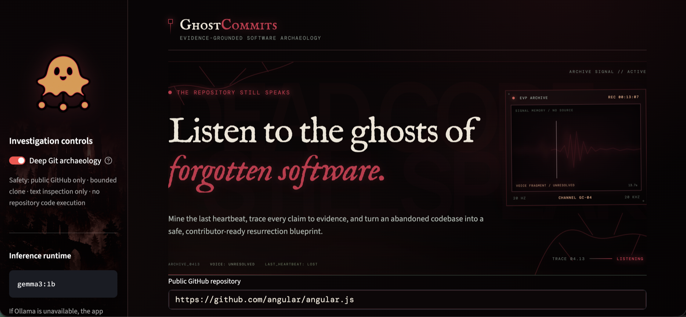
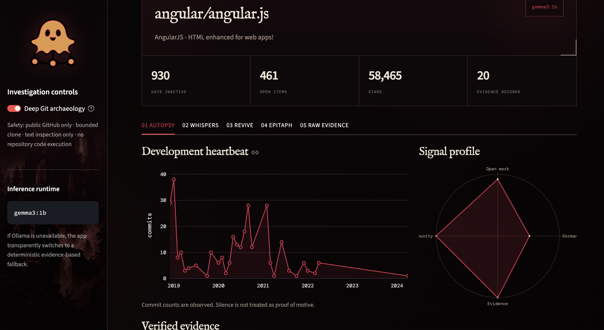
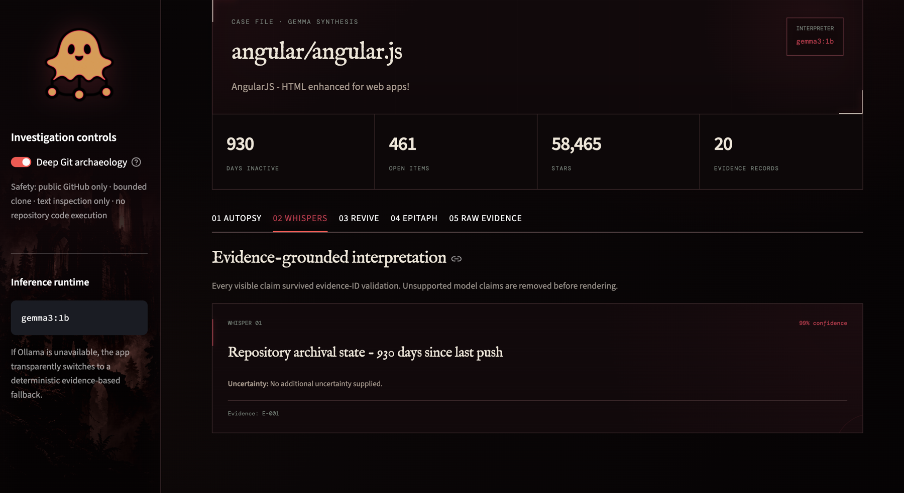
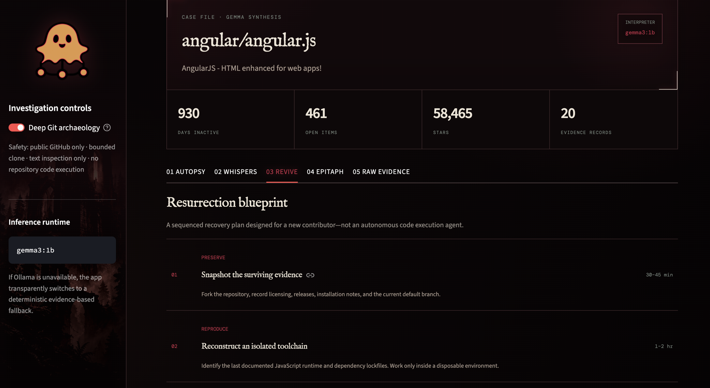
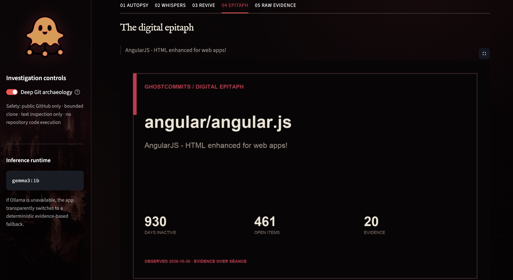

# GhostCommits

> Every abandoned repository has a story. GhostCommits finds the evidence, separates fact from inference, and turns the surviving trail into a safe resurrection plan.

GhostCommits is a competition-ready, open-source AI software archaeologist. It combines deterministic Git/GitHub mining with schema-constrained Gemma inference. Facts never come from the language model; the model may only interpret a validated evidence packet, and unsupported evidence IDs are rejected.



## Standout features

- **The Last Heartbeat** — real GitHub metadata plus bounded Git history mining.
- **Whispers from the Past** — Gemma produces structured, evidence-linked findings.
- **Claim Firewall** — unsupported citations never reach the interface.
- **Resurrection Blueprint** — a safe, contributor-ready recovery sequence.
- **Digital Epitaph** — a shareable PNG memorial generated from verified facts.
- **Adversarial safety** — public GitHub only, bounded clone, no code execution.

## Product tour

### 01 · Autopsy

The activity heartbeat and signal profile expose the repository's observable development history, while every displayed conclusion remains connected to verified evidence.



### 02 · Whispers

Gemma interpretations pass through the claim firewall before rendering, with evidence IDs, uncertainty, and confidence shown directly in each finding.



### 03 · Revive

The resurrection blueprint converts surviving repository evidence into a sequenced, contributor-ready recovery plan—without executing repository code.



### 04 · Epitaph

Each investigation produces a shareable digital epitaph summarizing the repository's verified state and key measurements.



## Quick start

Requirements: Python 3.10+, Git, and optionally Ollama for Gemma inference.

```bash
python3 -m venv .venv
source .venv/bin/activate
pip install -r requirements.txt
cp .env.example .env
ollama pull gemma3:1b
streamlit run app.py
```

`GITHUB_TOKEN` is optional but recommended to avoid anonymous API rate limits. Without Ollama, the deterministic pipeline still runs and clearly labels its fallback mode.

## Architecture

```text
Repository URL
    ├── GitHubClient ─ metadata, issues, contributors, languages
    └── GitAnalyzer ── bounded clone, commits, TODOs, README
                ↓
EvidenceBuilder ───── immutable records with IDs and source links
                ↓
GemmaEngine ───────── schema-constrained interpretation via Ollama
                ↓
ClaimValidator ────── reject unsupported citations
                ↓
ResurrectionPlanner ─ safe, sequenced recovery actions
                ↓
Streamlit UI ──────── timeline, whispers, roadmap, PNG + JSON
```

## Trust model

- Only public `github.com` repository URLs are accepted.
- Clone depth, blob size, checkout size, scanned file count, and file size are bounded.
- Submodules are not initialized; repository code and scripts are never executed.
- README, issue, commit, and TODO text is untrusted evidence, never instructions.
- Maintainer motive is reported only when explicitly present in a cited source.
- Model findings must cite an existing `E-##` record.

## Configuration

| Variable | Default | Purpose |
| --- | --- | --- |
| `GITHUB_TOKEN` | empty | Raises GitHub API limits |
| `OLLAMA_BASE_URL` | `http://127.0.0.1:11434` | Ollama endpoint |
| `GHOSTCOMMITS_MODEL` | `gemma3:1b` | Open-weight interpreter |
| `GHOSTCOMMITS_MAX_REPO_MB` | `250` | Recommended checkout cap |

## Tests

```bash
python -m unittest discover -s tests -v
python -m compileall app.py core ui tests
```

Tests cover URL validation, DNS and timeout failures, missing repositories, rate limiting, malformed GitHub responses, evidence generation, unsupported-claim rejection, confidence normalization, and resurrection planning without network calls.

## Reproducible evaluation

The competition evaluation uses one explicitly archived repository, one inactive but unarchived repository, and one active repository. It measures live source-link validity, evidence-ID support, lifecycle classification, recommendation actionability, AI usage, and end-to-end duration.

```bash
python -m evaluation.run_evaluation
```

The command requires GitHub access and a running `gemma3:1b` Ollama model. It writes the measured, inspectable report to `evaluation/results.json`. Fallback output is rejected by default so a benchmark cannot silently claim AI performance when Gemma is unavailable. See the [evaluation methodology](evaluation/README.md) for metric definitions and limitations.

Latest measured run (October 30, 2026): **3/3 classifications correct, 50/50 evidence URLs reachable, 3/3 findings supported, and 18/18 roadmap steps actionable.** Every case used Gemma rather than fallback output. Mean end-to-end duration was 60.60 seconds on the local M1 test machine. Full evidence and per-case timings are preserved in [`evaluation/results.json`](evaluation/results.json).

## Project layout

```text
ghostcommits/
├── app.py
├── requirements.txt
├── README.md
├── LICENSE
├── .env.example
├── core/
│   ├── github_client.py
│   ├── git_analyzer.py
│   ├── evidence_builder.py
│   ├── gemma_engine.py
│   ├── claim_validator.py
│   └── resurrection.py
├── ui/
│   ├── components.py
│   ├── charts.py
│   └── styles.css
├── tests/
├── evaluation/
│   ├── README.md
│   ├── run_evaluation.py
│   └── results.json
├── examples/sample_report.json
└── assets/
    ├── demo.png
    ├── logo.png
    ├── sidebar-haunt.png
    └── screenshots/
```

MIT licensed.
